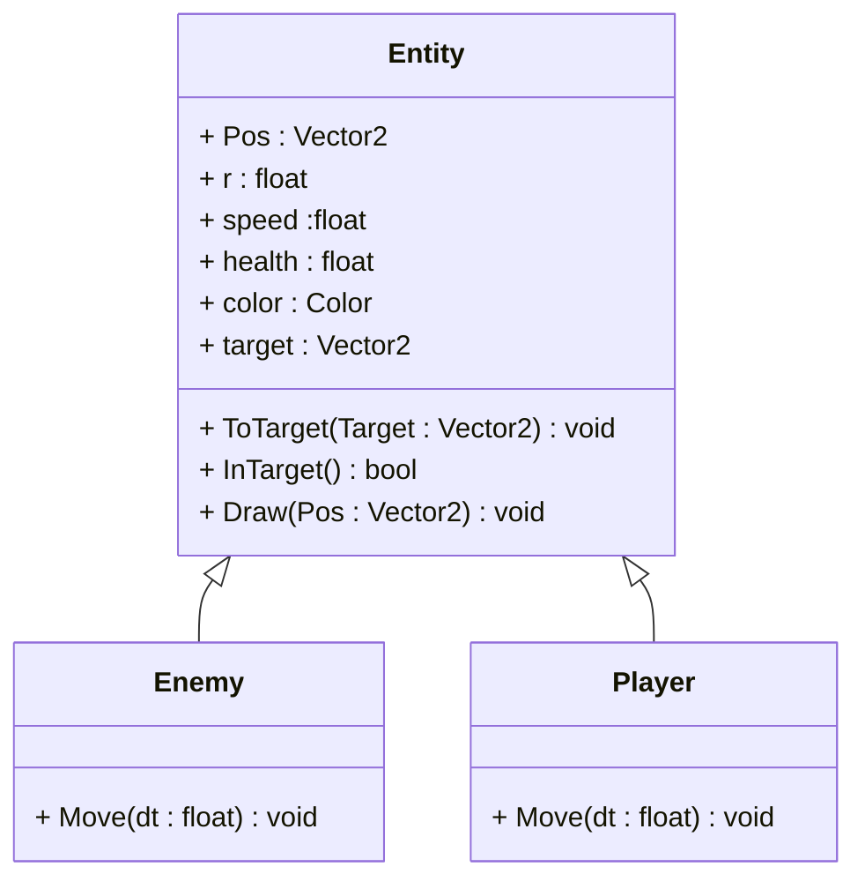

# Info

基于raylib

# 动画

1. x += dx * speed
  没有时间增量, 1s内移动的距离与帧率相关
2. x += dx * speed * dt
  引入时间增量, 保证1s内移动的距离相等
3. x += dv * dt
  速度矢量化, 移动不修改位置, 而是赋予实体一个速度
4. x += (da * dt) *dt

# 碰撞

> raylib 库有碰撞检测相关的函数, 但是我们自己实现, 我们力求只有绘制相关的工作交给Raylib

# 架构

# 技巧

- [X-marco](https://dsghbc.github.io/blog/2026/08/28/X-Macro-in-C)

# 移动

1. 数值驱动

player与enemy都继承自同一个实体, 他们使用的函数都是一样的, 但是只有每个实体的不同的属性不同, 所以产生了不同的行为.

2. 移动分层

我们设置移动, 其实本身是分为三层的.

| 分层     | Player       | Enemey             |
| -------- | ------------ | ------------------ |
| 意图层   | 丝滑的手感   | AI良好的追踪体验   |
| 运动层   | 积分模型     | 积分模型           |
| 参数     | ...          | ...                |

我们注意到了, 我们的其实本质在于通过参数的不同来控制意图层的不同.
